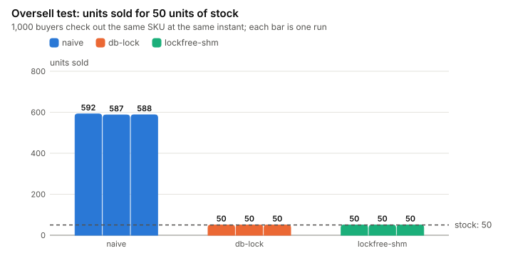
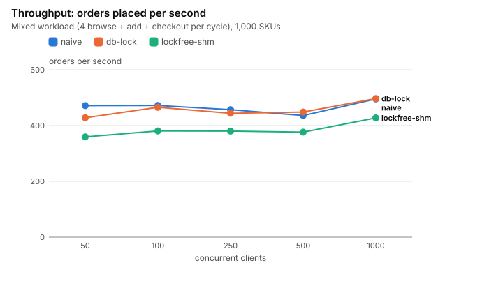
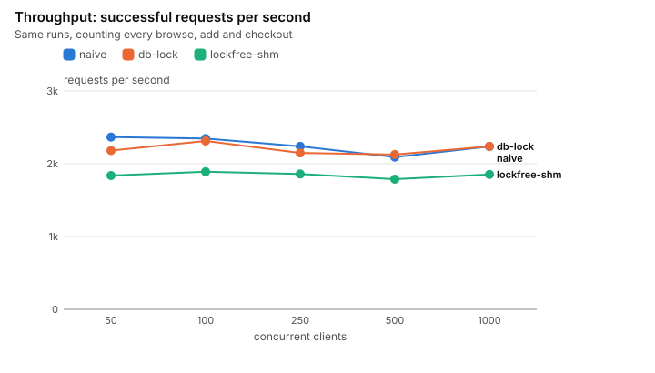
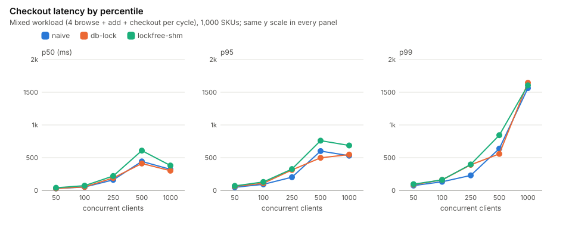
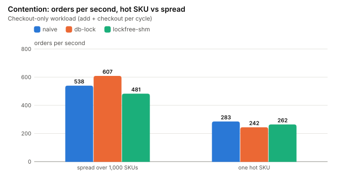
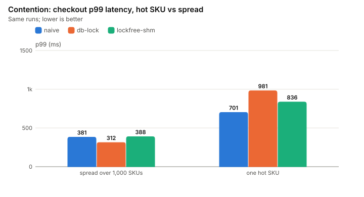
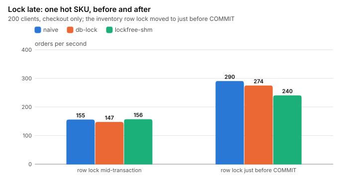
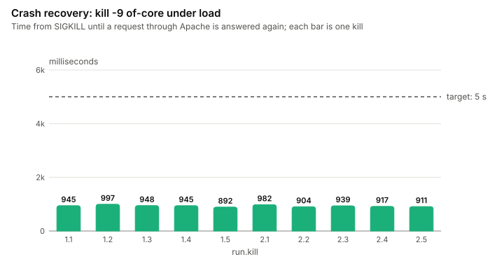
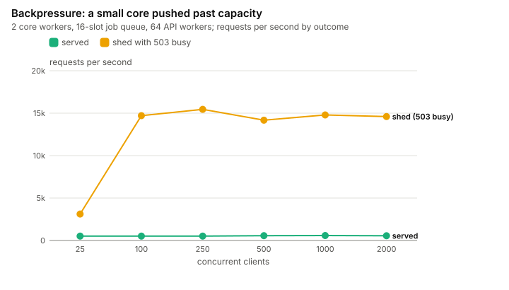
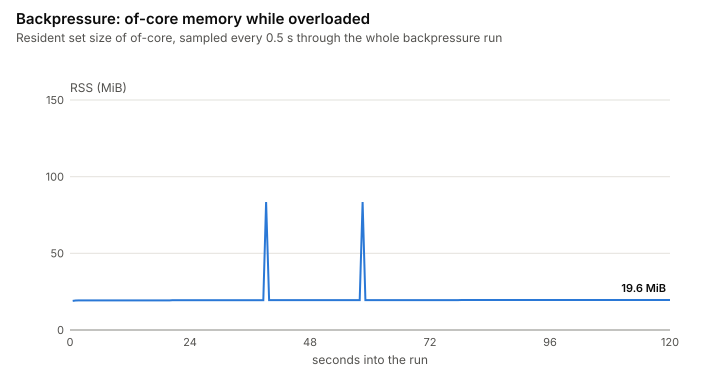

# Benchmark report (phase 6)

This report covers the five headline experiments from the project plan. It gives the
method, the machine, the results with charts, the invariant checks after every run,
and the limits of what the numbers show. Every number here comes from one run of
`scripts/bench-experiments.sh` on 24 November 2026. The raw CSVs, the full console
output and the hardware record are in [docs/benchmarks/](benchmarks/).

## Summary

| # | Experiment | Target | Result |
|---|---|---|---|
| 1 | Oversell: 1,000 buyers, 50 units | exactly 50 sold, 0 oversold in db-lock and lockfree-shm | **Met.** 50 sold in all 6 runs of those modes. Naive sold 587–592 (oversold by 537–542), as expected |
| 2 | Throughput and latency, 50 → 1,000 clients | record orders/s and p50/p95/p99 per mode | About 2,100–2,400 requests/s and 360–500 orders/s. The machine's CPUs are the limit, mostly MySQL |
| 3 | Contention: one hot SKU vs 1,000 SKUs | show where lock-free helps | One hot SKU halves throughput in **every** mode. Lock-free wins only when buyers lose: in a sell-out, its p50 is 350–450 ms against 630–765 ms for db-lock |
| 4 | Crash recovery: `kill -9` of-core under load | serving again in < 5 s, invariants intact | **Met.** 10 kills: 892–997 ms (median 942 ms), every invariant held |
| 5 | Backpressure: far past capacity | "busy", not a crash or growing memory | **Met.** Up to 15,000 requests/s refused with 503; of-core never restarted; its memory stayed at 19–20 MiB |

The suite also found a bottleneck. It was fixed in this phase: see "Lock late" below.

## 1. Method

### The machine

Everything ran on one laptop: the load generator, Apache, the OrderForge daemons and
MySQL. The record is in [benchmarks/hardware.txt](benchmarks/hardware.txt).

| | |
|---|---|
| CPU | Intel Core i5-1335U: 2 performance and 8 efficiency cores, 12 hardware threads, up to 4.6 GHz |
| Memory | 15 GiB |
| OS | Ubuntu 24.04.5 LTS, Linux 7.0 |
| MySQL | 8.0.46: InnoDB buffer pool 128 MiB, `innodb_flush_log_at_trx_commit = 1` (a disk flush on every commit) |
| Apache | 2.4.58, event MPM, 150 worker threads (the Ubuntu defaults) |
| Disk | NVMe SSD, ext4 |
| Build | `make MODE=release` (`-O2`), GCC 13.3 |
| Power | **On battery, `powersave` CPU governor.** Absolute numbers on mains power would be higher; the comparisons between modes ran under the same conditions |

### The OrderForge configuration

The suite runs its own stack from `conf/bench.conf`: your config plus these overrides.

| Setting | Value | Why |
|---|---|---|
| `api.rate_limit` | 0 | Every client comes from 127.0.0.1, so the per-IP limit would measure the limiter, not the engine |
| `pay.decline_pct`, `timeout_pct`, `duplicate_pct` | 0 | Every payment approves within 20–150 ms, so orders settle inside each run |
| `store.reservation_ttl_s` | 30 | Bounds the wait for payments to settle |
| `log.level` | warn | Per-request logging is not what is being measured |
| everything else | defaults | One core worker per CPU (12), a 1,024-slot job queue, 16 of-api workers, 4 payment workers, WAL group window 2 ms |

### The load generator (`of-bench`)

- **`oversell`.** Each buyer gets a session and a cart holding the product. Then:
  - every client thread opens all its sockets and waits at a barrier;
  - all 1,000 checkouts are written at the same instant.
- **`mix`.** Closed-loop clients, one thread each.
  - Each repeats a shopping cycle: 4 catalogue reads (alternating a product page and a
    list page), add one item to the cart, check out.
  - With `--browse 0` the cycle is only add and check out; this is the contention
    workload.
  - `--skus spread` picks items at random from 1,000 benchmark SKUs; `--skus hot`
    always picks the same one.
  - Each SKU starts with 1,000,000 units, so nothing sells out.
- **Timing.**
  - Each request is timed from `connect()` to the last byte, through Apache.
  - The first 3 s of each 15 s run are warm-up and not counted.
  - Percentiles are exact, from every sample.
- **After every run**, of-bench waits for every order's payment to settle, then checks
  the invariants:
  - stock on hand equals the ledger, and none is negative;
  - shared memory matches MySQL;
  - every paid order has exactly one successful payment;
  - no order is stuck past its deadline.
- **Fresh database.** The database is reset before each experiment and each stock
  mode.

### The three stock modes

| Mode | How a checkout takes stock |
|---|---|
| naive | Reads the stock, checks it, writes back `stock - qty`. Unsafe on purpose: the baseline |
| db-lock | `SELECT … FOR UPDATE` on the inventory row, then a guarded `UPDATE` |
| lockfree-shm | Compare-and-swap on a shared-memory counter, logged to the WAL (one disk flush), then the same guarded `UPDATE` in MySQL |

## 2. Experiment 1: oversell



1,000 buyers, 50 units, three runs per mode:

| Mode | Units sold | Oversold | Checkout p50 | p99 |
|---|---|---|---|---|
| naive | 592, 587, 588 | **542, 537, 538** | 2.28–2.35 s | 2.95–3.38 s |
| db-lock | 50, 50, 50 | 0 | 627–765 ms | 1.03–1.30 s |
| lockfree-shm | 50, 50, 50 | 0 | **350–447 ms** | **495–831 ms** |

- **db-lock** is correct, but the 950 losing buyers each queue for the row lock just to
  learn that the stock is gone.
- **lockfree-shm** rejects them with one compare-and-swap in shared memory, without a
  MySQL round trip. That roughly halves the median wait in a sell-out.
- **naive** loses updates. It is also the slowest mode here, because its 590 "winners"
  all write orders.

## 3. Experiment 2: throughput and latency

Mixed workload, 1,000 SKUs, 15 s per level.







| Mode | Clients | Requests/s | Orders/s | Checkout p50 | p95 | p99 | Invariants |
|---|---|---|---|---|---|---|---|
| naive | 50 | 2,366 | 471 | 29 ms | 47 ms | 73 ms | **fail** |
| naive | 250 | 2,239 | 457 | 161 ms | 202 ms | 229 ms | **fail** |
| naive | 1,000 | 2,238 | 496 | 322 ms | 530 ms | 1,562 ms | **fail** |
| db-lock | 50 | 2,182 | 428 | 31 ms | 61 ms | 87 ms | pass |
| db-lock | 250 | 2,149 | 444 | 190 ms | 313 ms | 391 ms | pass |
| db-lock | 1,000 | 2,239 | 497 | 301 ms | 548 ms | 1,644 ms | pass |
| lockfree-shm | 50 | 1,838 | 359 | 40 ms | 70 ms | 95 ms | pass |
| lockfree-shm | 250 | 1,859 | 380 | 220 ms | 326 ms | 397 ms | pass |
| lockfree-shm | 1,000 | 1,853 | 428 | 380 ms | 686 ms | 1,605 ms | pass |

All 15 rows, including 100 and 500 clients, are in
[benchmarks/throughput.csv](benchmarks/throughput.csv).

**Throughput is flat from 50 clients up.** The machine is saturated at 50.
- A CPU sample during a 250-client run showed 3% idle. MySQL used about 5.3 of the 12
  hardware threads, of-core about 1.3, and Apache, of-bench and of-pay about 2.
- More clients only add queueing, so latency grows with the client count, as Little's
  law predicts.

**At 1,000 clients the p99 jumps to about 1.6 s and the maximum to 3–5 s.**
- Apache has 150 workers, so the other 850 connections wait in its listen backlog.
- When the backlog overflows, the kernel drops the connection attempt and the client
  retries after 1 s, then 3 s.
- This is Apache's admission limit, and it is the same in every mode.

**Naive mode corrupts stock even with 1,000 SKUs.**
- In the first 50-client run, two buyers of BENCH-0084 overlapped: 8 units were sold,
  but stock went down by 7.
- The invariant checker caught it (`ledger-mismatch`). The later naive runs report the
  same corrupted row.
- Lost updates are not only a flash-sale problem.

**lockfree-shm is about 15% slower than db-lock when every order succeeds.**
- Before touching MySQL, each lock-free checkout waits for its reservation to reach
  the write-ahead log on disk (§8 of the design). So it pays two synchronous flushes,
  the WAL's and MySQL's commit, where db-lock pays one.
- Two side runs (contention workload, spread SKUs) confirmed this:
  - changing the WAL group window from 2 ms to 0.5 ms or 0 changed little
    (465–497 orders/s);
  - putting the WAL on tmpfs, where a flush costs nothing, raised lock-free from
    465 to 550 orders/s.
- So about half of the gap is the flush. The rest is the reservation bookkeeping and
  run-to-run noise.
- This is the price of a reservation table that survives `kill -9` (experiment 4). The
  win comes when buyers lose (experiment 1).

## 4. Experiment 3: contention

Checkout-only workload, 200 clients.





| Mode | SKUs | Orders/s | Checkout p50 | p99 | Invariants |
|---|---|---|---|---|---|
| naive | spread | 538 | 215 ms | 381 ms | **fail** |
| naive | hot | 283 | 445 ms | 701 ms | **fail** |
| db-lock | spread | 607 | 206 ms | 312 ms | pass |
| db-lock | hot | 242 | 530 ms | 981 ms | pass |
| lockfree-shm | spread | 481 | 261 ms | 388 ms | pass |
| lockfree-shm | hot | 262 | 487 ms | 836 ms | pass |

**One hot SKU cuts throughput by half or more in every mode, including the lock-free
one.**
- Shared memory decides who gets the stock without locks, but every successful order
  still runs `UPDATE inventory … WHERE product_id = ?` in its MySQL transaction.
- InnoDB holds that row's lock until COMMIT, and the commit includes a disk flush.
  Buyers of the same product therefore commit one at a time, and InnoDB's group commit
  cannot batch them.
- Even naive mode queues here, because its `UPDATE` takes the same row lock.

**Where lock-free helps most** is when there is no stock to take (experiment 1): a
losing buyer never reaches MySQL.

### Lock late (found and fixed by this experiment)

The first contention run showed only 147–156 orders/s on the hot SKU. Tracing the
checkout transaction showed why:
- The inventory `UPDATE` ran early in the transaction.
- Eight more statements followed it: order items, ledger, reservations, payment,
  events, cart, and so on. The row stayed locked through all of them.

The fix: make the inventory `UPDATE` the last statement before COMMIT, still in
ascending product id. This also matches the lock order documented in design §7.



Hot SKU, 200 clients (from [benchmarks/ablation.csv](benchmarks/ablation.csv)):

| Mode | Before | After | Speed-up |
|---|---|---|---|
| naive | 155 orders/s | 290 orders/s | 1.9× |
| db-lock | 147 orders/s | 274 orders/s | 1.9× |
| lockfree-shm | 156 orders/s | 240 orders/s | 1.5× |

- Spread-SKU throughput did not change: rows are rarely shared there, so nobody was
  waiting.
- The final results above all use the new order.

## 5. Experiment 4: crash recovery

`scripts/chaos.sh`, run twice:
- 100 clients shop for 72 s, with sustained checkouts;
- `kill -9` hits of-core 5 times per run, 12 s apart;
- "Serving again" means a request through Apache that needs of-core succeeds.



| | Run 1 | Run 2 |
|---|---|---|
| Kill → serving again | 945, 997, 948, 945, 892 ms | 982, 904, 939, 917, 911 ms |
| WAL replay and reconciliation (last start) | 47 ms | 76 ms |
| In-flight reservations resolved by asking MySQL | 10 committed, 24 released | 11 committed, 14 released |
| Lost or duplicated checkouts | 0 | 0 |
| Invariants afterwards | all pass | all pass |

**Median 942 ms, worst 997 ms, against a 5 s target.** Most of that time is not
recovery work:
- the supervisor's first restart delay (100 ms);
- starting the process: shared memory, 12 workers, MySQL connections;
- of-api noticing the new socket.

Replaying the log takes under 80 ms.

The kills were spaced 12 s apart on purpose. The supervisor doubles its restart delay
after each crash and resets it only after 10 s of uptime. In an earlier run with kills
8 s apart, the delay doubled every time (100, 200, 400, 800, 1,600 ms), so recovery
times rose from 0.87 s to 2.5 s. That is crash-loop protection working as designed,
not slower recovery.

## 6. Experiment 5: backpressure

The core is deliberately small:
- 2 workers and a 16-slot job queue;
- 64 of-api workers, so that far more requests reach it than it can hold.

The client count rose from 25 to 2,000. Clients retry immediately after a 503 on
catalogue reads, so the offered load is far above capacity.



| Clients | Served/s | Refused with 503 "busy" | Checkout p99 | Invariants |
|---|---|---|---|---|
| 25 | 515 | 46,777 in 15 s | 97 ms | pass |
| 100 | 515 | 220,609 | 163 ms | pass |
| 250 | 517 | 231,811 | 176 ms | pass |
| 500 | 564 | 212,567 | 176 ms | pass |
| 1,000 | 584 | 221,899 | 1,112 ms | pass |
| 2,000 | 561 | 218,981 | 1,308 ms | pass |



- **Served work stays flat** at what two workers can do (about 520–580 requests/s).
  Everything beyond that is refused in microseconds with 503 `busy`, at up to about
  15,000 per second.
- **of-core never crashed or restarted.** Its pid was the same before and after
  (supervisor restarts: 0).
- **Memory did not grow.** of-core's resident memory stayed between 19.4 and 20.0 MiB
  for the whole two minutes, because the queue is a fixed array.
  - The two spikes to 85 MiB are single samples between load levels, while
    of-bench's setup requests were running and the job queue was empty. The memory
    was returned by the next sample.
- **Orders/s is low** (7–29) for a reason: a cycle needs several requests in a row to
  succeed, and most are refused.

## 7. Invariants

Every run ended with the full invariant check. Every db-lock and lockfree-shm run
passed. That covers:
- 6 oversell runs;
- 10 throughput levels;
- 4 contention runs;
- 2 chaos runs with 10 crashes;
- 6 backpressure levels.

Every naive run failed, which is the point of the baseline.

## 8. Limitations

- **One machine.** The load generator shares the CPUs with the system it measures.
  Separate client machines would show higher throughput.
- **On battery, `powersave` governor**, with a browser and an editor open (about 2 of
  the 12 hardware threads). Absolute numbers would be higher on mains power with
  nothing else running. The comparisons between modes ran back to back under the same
  conditions.
- **MySQL is untuned.** It has a 128 MiB buffer pool and a disk flush on every commit.
  MySQL is the largest CPU user, so tuning it would raise every mode.
- **Connections are not reused.** Every request opens a new TCP connection to Apache,
  and Apache opens a new FastCGI connection to of-api (connection reuse deadlocks with
  libfcgi; see design §3). Keep-alive clients would be cheaper per request.
- **Single runs.** Each throughput and contention point is one 15 s run. The oversell
  test, repeated 3 times, shows about ±20% spread in latency between runs. Treat
  differences under about 10% as noise.
- **Synthetic payments.** The mock gateway always approves, after 20–150 ms. Real
  gateways are slower, which would lengthen how long stock stays reserved, not the
  checkout itself.

## 9. Reproducing

```sh
make MODE=release
./build/debug/of-ctl -c conf/orderforge.conf stop   # the suite runs its own stack
scripts/bench-experiments.sh --yes                  # about 30 minutes; resets the database
```

- Results go to `bench-results/run-<timestamp>/`, with charts.
- To redraw the charts in this report: `python3 scripts/plot-bench.py docs/benchmarks docs/benchmarks/charts`.
- To repeat the WAL side runs: `EXPERIMENTS=contention MODES=lockfree-shm EXTRA_CONF="core.wal_group_us = 0" scripts/bench-experiments.sh --yes`.
- Details are in the installation guide, section 11.
