# User manual

The site runs at <http://localhost:8080/> once it is installed (see
[install.md](install.md)). The demo data includes these accounts:

| Account | Password | Role |
|---|---|---|
| `alice@example.com` | `customer123` | customer |
| `bob@example.com` | `customer123` | customer |
| `admin@orderforge.local` | `admin12345` | administrator |

These passwords are public. Before anyone else uses the site, create your own admin
account (the password is read from standard input):

```sh
echo 'a-long-new-password' | ./build/debug/of-ctl useradd --admin you@example.com "Your Name"
```

The screenshots were taken from a demo database by `scripts/take-screenshots.py`.

## Customers

### Create an account or log in

Choose **Log in** at the top right.

- **New customers:** use **Create an account**. Your name, email and a password of at
  least 8 characters are all you need, and you are logged in straight away.
- **Existing customers:** use the **Log in** form. After five wrong passwords in a
  row, the account is locked for a short time.

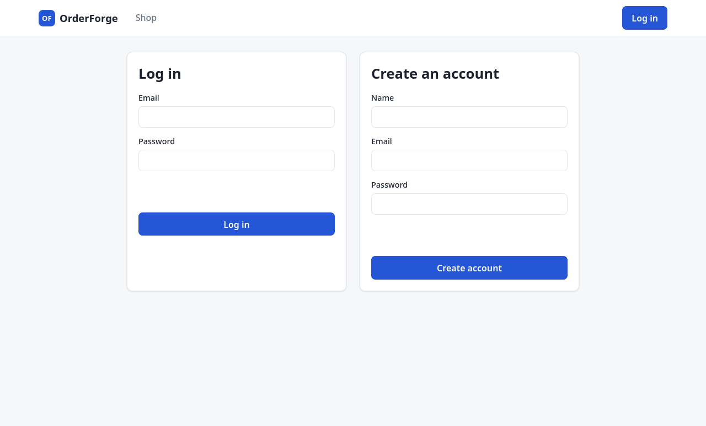

### Find products

The **Shop** page lists every product, 12 per page.

- Type in the search box to match product names or SKUs.
- Pick a category to filter the list.
- Each card shows the price and stock status: *In stock*, *Only N left* or
  *Out of stock*.
- Open a product to read its description and choose a quantity.

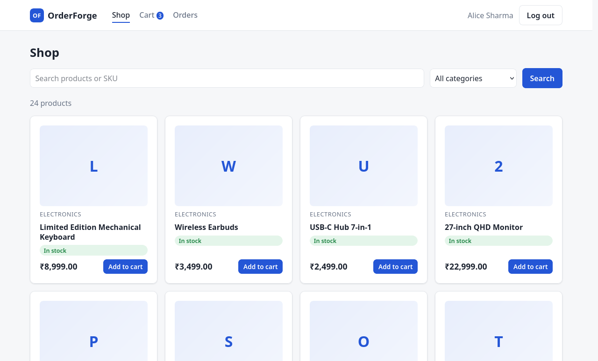

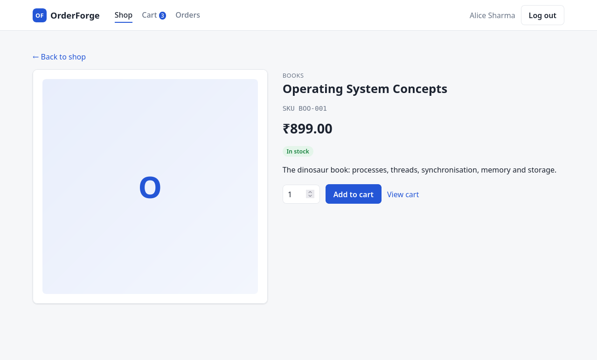

### Cart

**Add to cart** puts one unit in your cart from the Shop page, or the chosen quantity
from a product page. The **Cart** link in the header shows how many items you have.

On the cart page you can:

- change a quantity, from 1 to 100;
- remove a line;
- see the running total.

Prices always come from the store, so they cannot be changed in the browser.

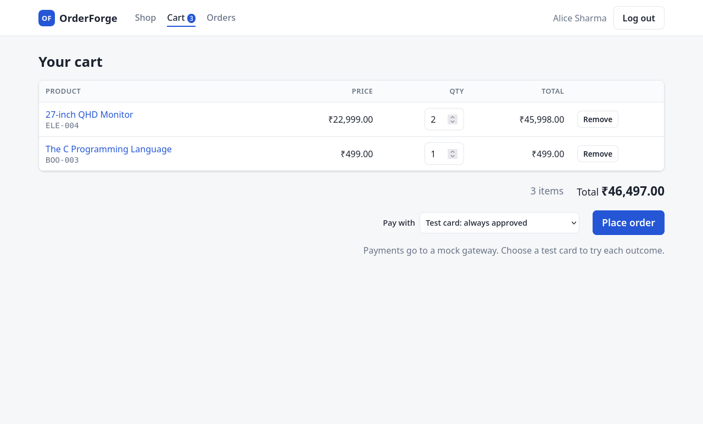

### Place an order and pay

Choose a test card under **Pay with**, then choose **Place order**.

| Test card | Outcome |
|---|---|
| Always approved | The payment is approved |
| Always declined | The payment is declined |
| Gateway never answers | The gateway stays silent |
| Approved, reply sent twice | Approved, with the gateway's reply arriving twice |
| Random outcome | Any of the above |

No real card details are asked for or stored.

- **If an item has run out:** the order is not placed, and a message names the product
  and how many are left.
- **If the order is placed:** you go to its tracking page.
  - While the payment is processing, the page shows *Waiting for the payment gateway*
    and how many seconds your items stay reserved.
  - **Approved:** the order becomes *Paid*.
  - **Declined, or no answer in time:** the order is cancelled, nothing is charged,
    and the items go back on sale.
- **Clicking twice, or retrying after a network error,** never creates a second order.

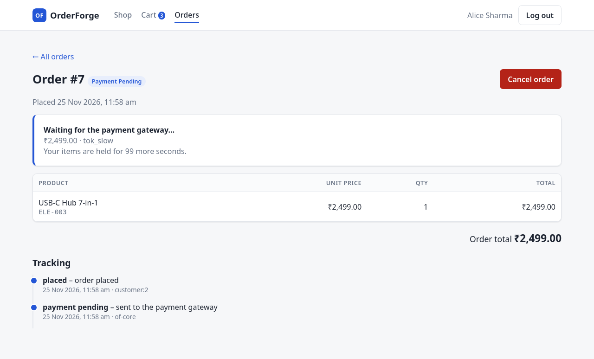

### Track orders

**Orders** lists every order you have placed. Open one to see its items, total,
payment status and a **Tracking** timeline of every status change. The page refreshes
itself every 2 seconds until the order is finished.

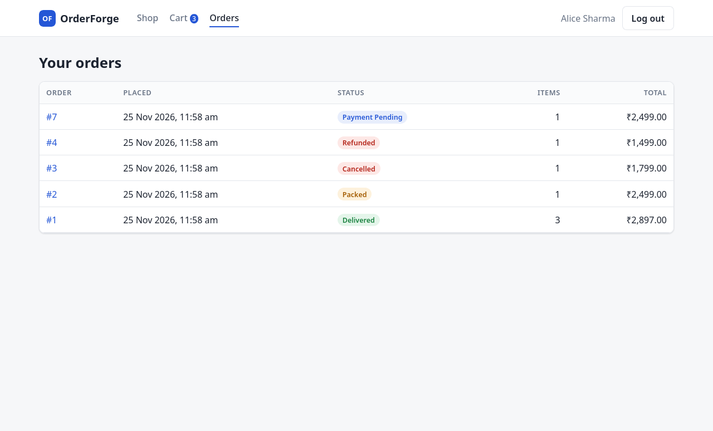

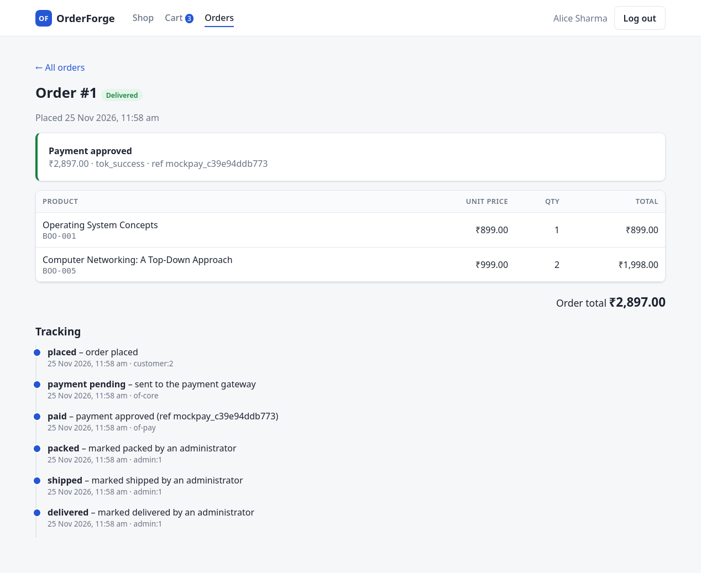

### Cancel an order

On an order's page:

- **Before payment:** **Cancel order** cancels it.
- **Paid but not yet packed:** **Cancel and refund** refunds it.
- **Packed or later:** it can no longer be cancelled from the shop.

## Administrators

Log in with an admin account. An **Admin** link appears in the header.

### Products (Admin → Products)

- **Add a product:** fill in the SKU, name, price in rupees, category, opening stock,
  reorder level and description. The SKU may contain only capital letters, digits
  and `-`.
- **Edit:** choose **Edit** on a row, change the fields, then **Save changes**.
- **Delete:** this hides the product from the shop and removes it from every cart.
  Past orders still show it. **Restore** brings it back.
- **Adjust stock:** enter an amount, then choose a reason.
  - **Restock** adds the amount.
  - **Adjust** can add or remove, for example after breakage or a recount.
  - Stock can never go below zero.
- **Show only low-stock products** lists the products at or below their reorder
  level.

Every change is recorded in the audit log and the stock ledger.

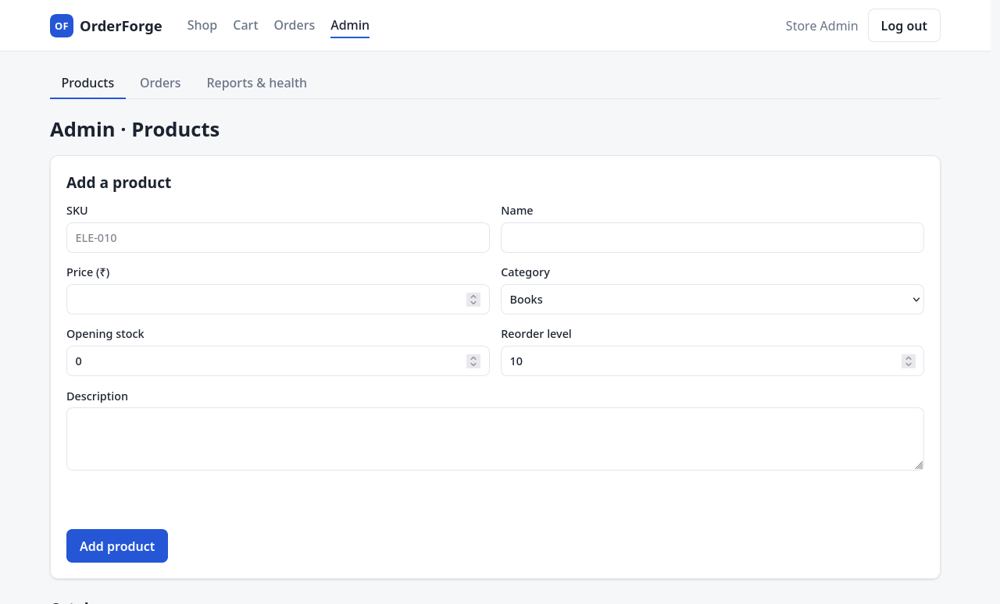

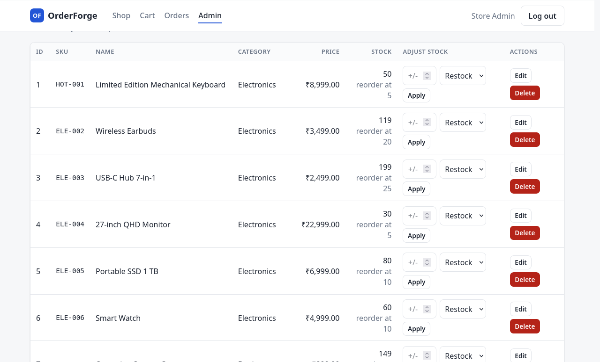

The admin pages have three tabs: **Products**, **Orders** and **Reports & health**.

### Orders (Admin → Orders)

Lists every order with its customer, status, item count and total. You can filter by
status, and the board refreshes itself every 5 seconds.

Each row shows only the moves allowed from its current state:

| Status | Buttons |
|---|---|
| Paid | **Mark packed**, **Refund** |
| Packed | **Mark shipped**, **Refund** |
| Shipped | **Mark delivered** |
| Unpaid | **Cancel** |

- Refunds and cancellations return the stock.
- Only the payment gateway can mark an order *Paid*.
- Open an order to see its payment and full timeline. The same buttons appear there.

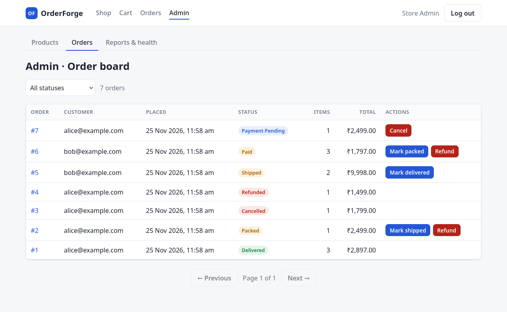

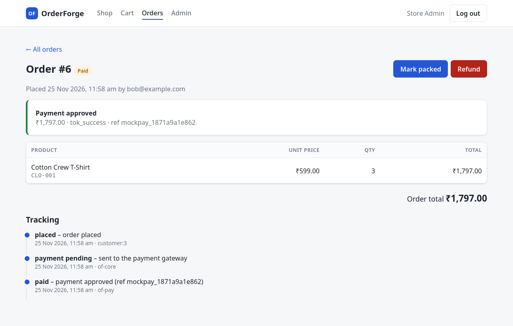

### Reports & health (Admin → Reports & health)

- **Figures for the last 7, 30 or 90 days:** revenue, paid orders, units sold and
  average order value.
- **Daily revenue chart:** hover over a bar for the day's figures; choose *Show as a
  table* for the numbers.
- **Lists:** top products, the low-stock list, and live counts of orders by status and
  payments by outcome.
- **Export CSV** downloads the latest report files written by of-report.
- **System health** updates every 2 seconds. It shows:
  - the stock mode;
  - requests, queue depth and busy rejections;
  - CAS retries;
  - payment outcomes (sent, approved, declined, duplicates ignored, forged messages
    rejected, late payments refunded);
  - expired reservations.

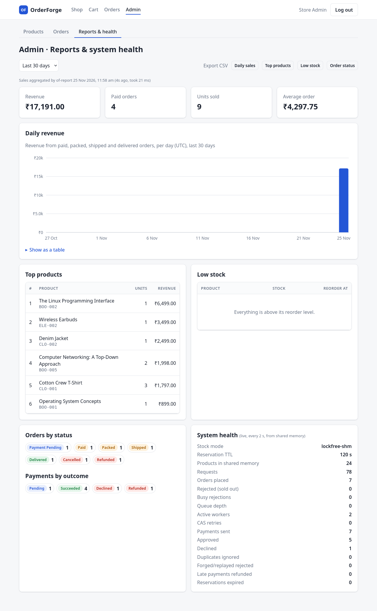

## Operators

The daemons run under `of-supervisor` (`scripts/run.sh`), which restarts any that
crash. Customers notice a crash of the engine only as a second or two of "please retry".
A retried checkout never creates a second order.

| Command | What it does |
|---|---|
| `of-ctl status` | Each daemon's state and restarts, live traffic and latency, payment outcomes, write-ahead-log activity and crash-recovery counters |
| `of-ctl invariants` | Proves stock, payments and timelines are consistent |
| `of-ctl stuck` | Lists any order that should have moved on |
| `of-ctl reload` | Applies configuration changes (log level, timeouts, gateway behaviour, report interval) and retries a daemon marked failed |
| `of-ctl stop` | Shuts everything down cleanly, finishing requests in progress |
